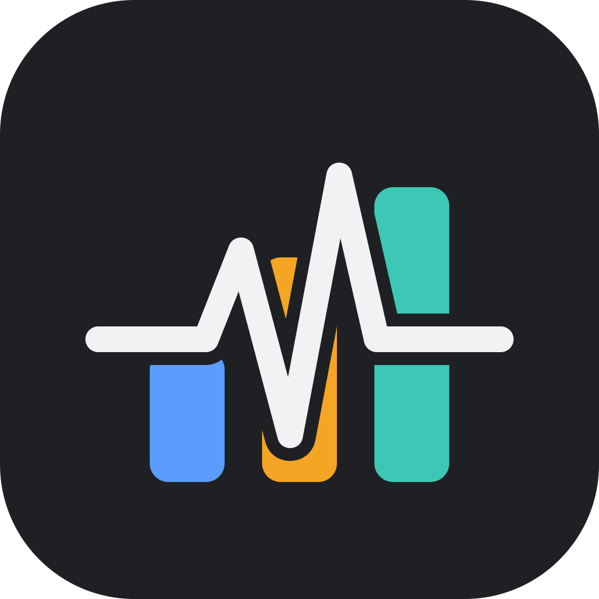
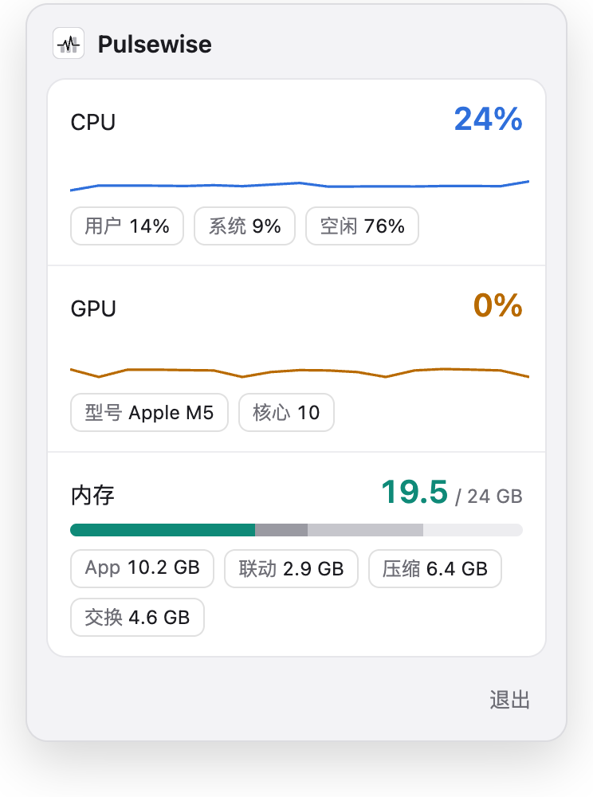

<p align="center">
  
</p>

<h1 align="center">Pulsewise</h1>

<p align="center">Your Mac's CPU, GPU, memory and disk capacity in the menu bar: readable at a glance, one click for the details.</p>

<p align="center">
  
  
  
</p>

<p align="center"><a href="README.md">简体中文</a> · <b>English</b></p>

<p align="center">
  
</p>

## Features

- **Configurable menu bar columns**: CPU, GPU and memory by default. Right-click the icon and use “菜单栏显示” to select 1–4 metrics from CPU, GPU, memory and disk. Changes apply immediately and persist after restart. Columns refresh every second, adapt to light and dark menu bars, and match the tooltip order.
- **Dropdown panel**: left-click the icon to open it. CPU and GPU come with a sparkline of the last 17 seconds.
  - CPU: user / system / idle
  - GPU: utilization, model, core count
  - Memory: split the way Activity Monitor splits it (App, wired, compressed), plus swap
  - Disk: startup disk used, available and total capacity, plus usage, refreshed every second. The capacity bar warns at 90% usage. Hover over the menu bar icon to see disk usage too.
- **Stays out of the way**: no Dock icon, not in ⌘Tab. The panel doesn't take focus, hides when it loses focus or on Esc, and opens on any Space, including over full-screen apps.
- **Light, no permissions**: samples through system APIs directly. No root, no background service.

Right-click the icon to choose metrics, restore the defaults or quit. The dropdown panel always shows all monitoring details.

> The panel's labels are in Chinese.

## Download and install

Download the latest `.dmg` from [Releases](https://github.com/FriendlyPasser/pulsewise/releases/latest), open it, and drag `Pulsewise.app` into the Applications folder.

- **Requirements**: macOS 13 or later, Apple silicon or Intel Mac (universal binary).
- **Signed & notarized**: release builds are signed with a Developer ID and notarized by Apple.
- **Auto-update**: release builds check for and download updates automatically; click the update button in the panel to restart into the new version, or trigger a check from the right-click menu. Auto-update only works for release builds placed in a writable location such as Applications; source builds do not check for updates.

## Build from source

Requires macOS, Go 1.27+ and the Xcode command line tools (the sampler uses cgo).

```sh
git clone https://github.com/FriendlyPasser/pulsewise.git
cd pulsewise
go build -o bin/pulsewise .
./bin/pulsewise
```

To work on the panel page, serve it to a browser instead of the menu bar:

```sh
./bin/pulsewise -web 127.0.0.1:8765
```

## Development

The [architecture notes](docs/architecture.md), in Chinese, describe module ownership, dependency rules, and concurrency contracts.

Run the checks with Node.js and Python 3 installed:

```sh
sh tools/check.sh
```

## License

[MIT](LICENSE)
