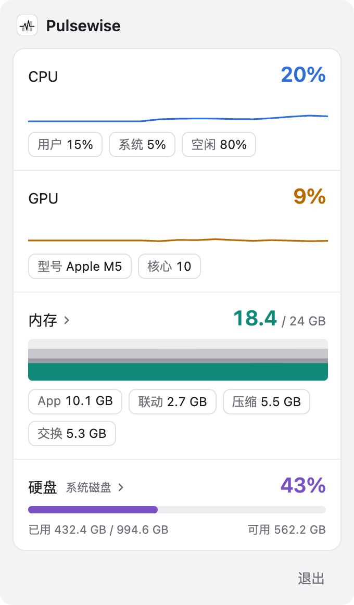

<p align="center">
  
</p>

<h1 align="center">Pulsewise</h1>

<p align="center">Monitor CPU, GPU, memory and disk usage from your Mac’s menu bar.</p>

<p align="center">
  
  
  
</p>

<p align="center"><a href="README.md">简体中文</a> · <b>English</b></p>

<p align="center">
  
</p>

## Download and install

Open the latest DMG, drag `Pulsewise.app` into Applications, then launch it. Look for three bars in the menu bar. Pulsewise has no Dock icon. [Download from GitHub Releases](https://github.com/FriendlyPasser/pulsewise/releases/latest)

The signed and notarized app runs on macOS 13 or later and supports both Apple silicon and Intel Macs. The interface follows your system language and supports Simplified Chinese and English.

## Read the menu bar and panel

The three bars show CPU, GPU and memory usage, refreshed once a second. Hover over the icon for percentages. To add disk usage or hide a metric, right-click the icon and open **Menu Bar Display**. Pulsewise remembers your selection.

Click the icon to see all four metrics, including any hidden from the menu bar. The panel shows the last 17 samples of CPU and GPU usage, a breakdown of memory use, and used and available space on the startup disk. Press Esc to close it.

## Find what uses memory or disk space

Click **Memory** or **Disk** in the panel to open the detail window. Use the tabs at the top to switch between them.

- **Memory** plots app, wired and compressed memory over time and shows swap usage separately. The list ranks your apps by physical memory footprint, including their helper processes. Expand an app to see its processes. Processes with no associated app appear in a separate group.
- **Disk** lets you choose a folder and scan for the 100 largest files by space occupied on disk. You can cancel a scan or reveal a result in Finder. The scan summary reports directories your account could not read.

## Login and updates

Right-click the menu bar icon and select **Open at Login** to start Pulsewise when you sign in. Release builds check for updates and download them automatically. When an update is ready, click **Update** in the panel to restart. For a manual check, choose **Check for Updates** from the right-click menu. macOS may ask for administrator approval to replace the installed app.

## Build from source

Requires macOS, Go 1.27.3+ and the Xcode command line tools (the sampler uses cgo).

```sh
git clone https://github.com/FriendlyPasser/pulsewise.git
cd pulsewise
go build -o bin/pulsewise .
./bin/pulsewise
```

To work on the panel page, serve it to a browser instead of the menu bar:

```sh
./bin/pulsewise -web 127.0.0.1:8765
```

Open `http://127.0.0.1:8765/` to view the panel.

## Development

The [architecture notes](docs/architecture.md), in Chinese, describe module ownership, dependency rules, and concurrency contracts.

Run the checks with Node.js and Python 3 installed:

```sh
sh tools/check.sh
```

## License

[MIT](LICENSE)
