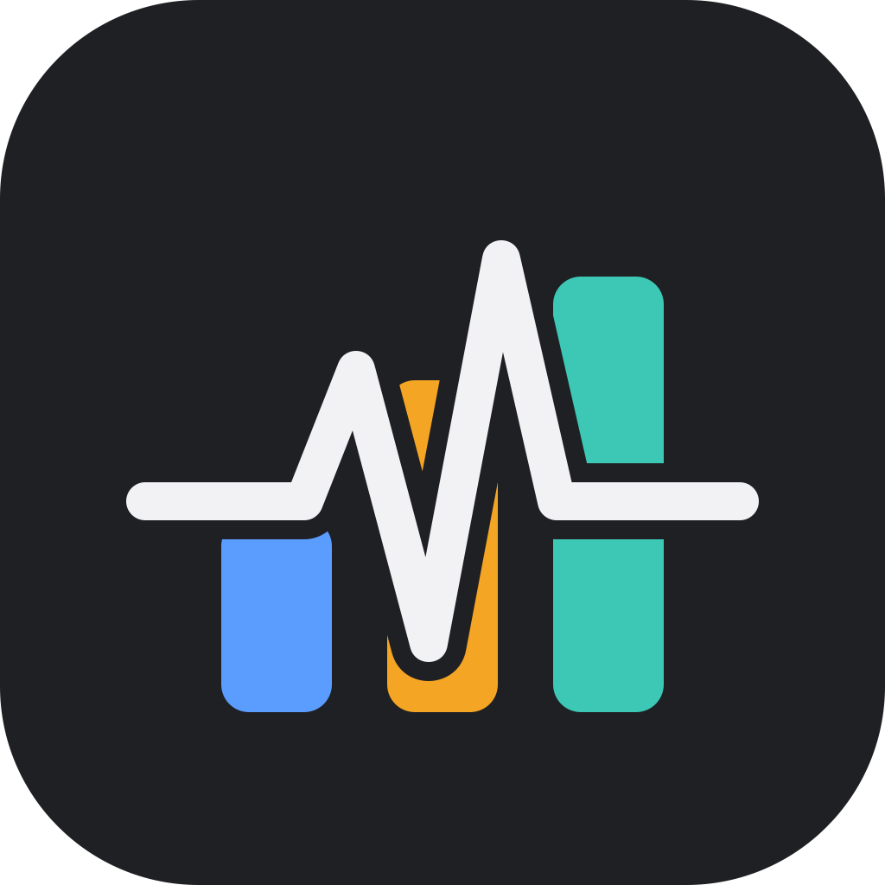
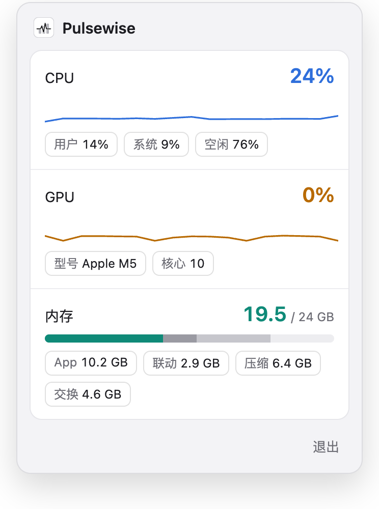

<p align="center">
  
</p>

<h1 align="center">Pulsewise</h1>

<p align="center">把 Mac 的 CPU、GPU、内存和硬盘容量放进菜单栏，一眼看清，一点即开。</p>

<p align="center">
  
  
  
</p>

<p align="center"><b>简体中文</b> · <a href="README.en.md">English</a></p>

<p align="center">
  
</p>

## 特性

- **可配置菜单栏柱子**：默认显示 CPU、GPU、内存三柱。右键图标，在“菜单栏显示”中勾选 CPU、GPU、内存、硬盘，可显示 1 到 4 项；选择会自动保存，立即生效。每秒刷新，自动适配深浅色菜单栏，悬停提示与柱子顺序一致。
- **下拉面板**：左键点击图标展开，CPU 和 GPU 带最近 17 秒的走势曲线。
  - CPU：用户 / 系统 / 空闲占比
  - GPU：使用率、型号、核心数
  - 内存：按“活动监视器”的口径拆分为 App、联动、压缩，另列交换
  - 硬盘：系统磁盘的已用、可用、总容量和使用率，每秒刷新；使用率达到 90% 时容量条变为警示色，悬停菜单栏图标也可查看使用率
- **不打扰**：没有 Dock 图标，不进 ⌘Tab；面板不抢焦点，失焦或按 Esc 自动收起，在任意桌面和全屏应用上都能打开。
- **轻量、免权限**：直接调用系统接口采样，无需 root，也没有后台服务。

右键图标可配置显示项目、恢复默认或退出。下拉面板始终保留全部监控详情。

## 下载安装

从 [Releases](https://github.com/FriendlyPasser/pulsewise/releases/latest) 下载最新的 `.dmg` 安装包，打开后将 `Pulsewise.app` 拖入“应用程序”文件夹即可使用。

- **系统要求**：macOS 13 或更新版本，支持 Apple 芯片与 Intel Mac（通用二进制）。
- **签名与公证**：发布版已使用 Developer ID 签名并通过 Apple 公证。
- **自动更新**：发布版会自动检查并下载新版本，点击面板中的“更新”按钮重启即可完成更新，也可通过右键菜单手动检查更新。自动更新仅对安装在“应用程序”等可写目录的发布版生效，从源码构建不会检查更新。

## 从源码构建

需要 macOS、Go 1.27+ 以及 Xcode 命令行工具（采样代码使用 cgo）。

```sh
git clone https://github.com/FriendlyPasser/pulsewise.git
cd pulsewise
go build -o bin/pulsewise .
./bin/pulsewise
```

调试面板页面时，可以让它在浏览器里运行，不启动菜单栏：

```sh
./bin/pulsewise -web 127.0.0.1:8765
```

## 开发

[架构说明](docs/architecture.md)介绍模块职责、依赖方向和并发约定。

运行完整检查需要 Node.js 和 Python 3：

```sh
sh tools/check.sh
```

## 许可证

[MIT](LICENSE)
