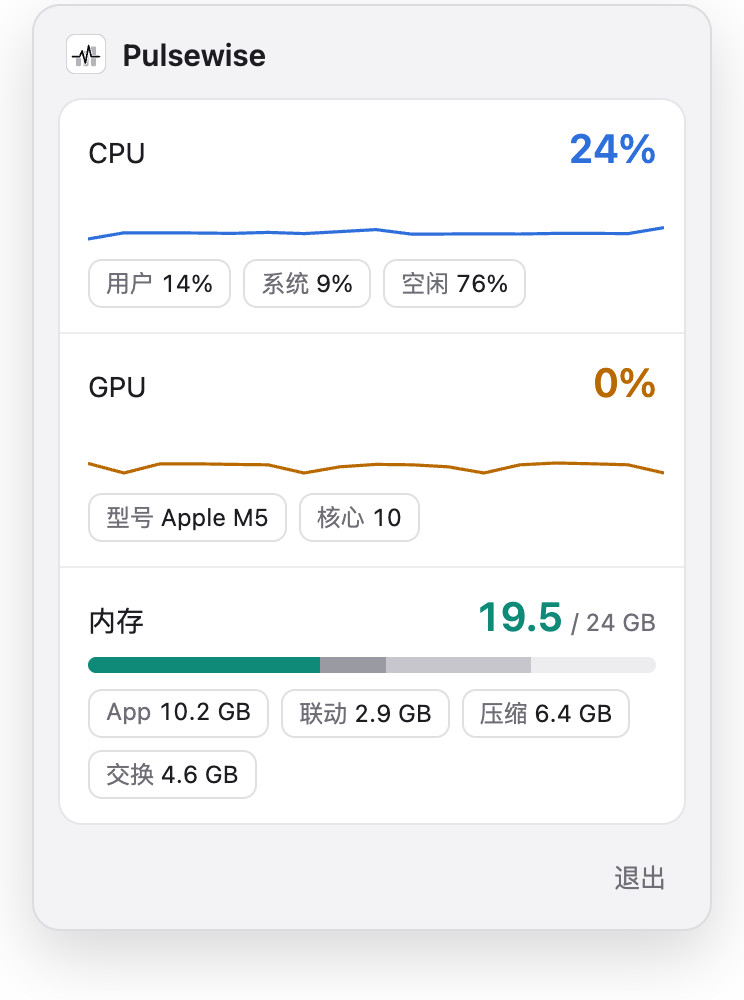

<p align="center">
  
</p>

<h1 align="center">Pulsewise</h1>

<p align="center">把 Mac 的 CPU、GPU 和内存放进菜单栏，一眼看清，一点即开。</p>

<p align="center">
  
  
  
</p>

<p align="center"><b>简体中文</b> · <a href="README.en.md">English</a></p>

<p align="center">
  
</p>

## 特性

- **菜单栏三柱图标**：三根柱子分别对应 CPU、GPU、内存，每秒刷新；模板图标，自动适配深色与浅色菜单栏。悬停显示具体百分比。
- **下拉面板**：左键点击图标展开，CPU 和 GPU 带最近 17 秒的走势曲线。
  - CPU：用户 / 系统 / 空闲占比
  - GPU：使用率、型号、核心数
  - 内存：按“活动监视器”的口径拆分为 App、联动、压缩，另列交换
- **不打扰**：没有 Dock 图标，不进 ⌘Tab；面板不抢焦点，失焦或按 Esc 自动收起，在任意桌面和全屏应用上都能打开。
- **轻量、免权限**：直接调用系统接口采样，无需 root，也没有后台服务。

右键图标可退出。

## 安装与运行

需要 macOS、Go 1.27+ 以及 Xcode 命令行工具（采样代码使用 cgo）。

```sh
git clone https://github.com/FriendlyPasser/pulsewise.git
cd pulsewise
go build -o bin/pulsewise .
./bin/pulsewise
```

调试面板页面时，可以让它在浏览器里运行，不启动菜单栏：

```sh
./bin/pulsewise -web 127.0.0.1:8765
```

## 许可证

[MIT](LICENSE)
