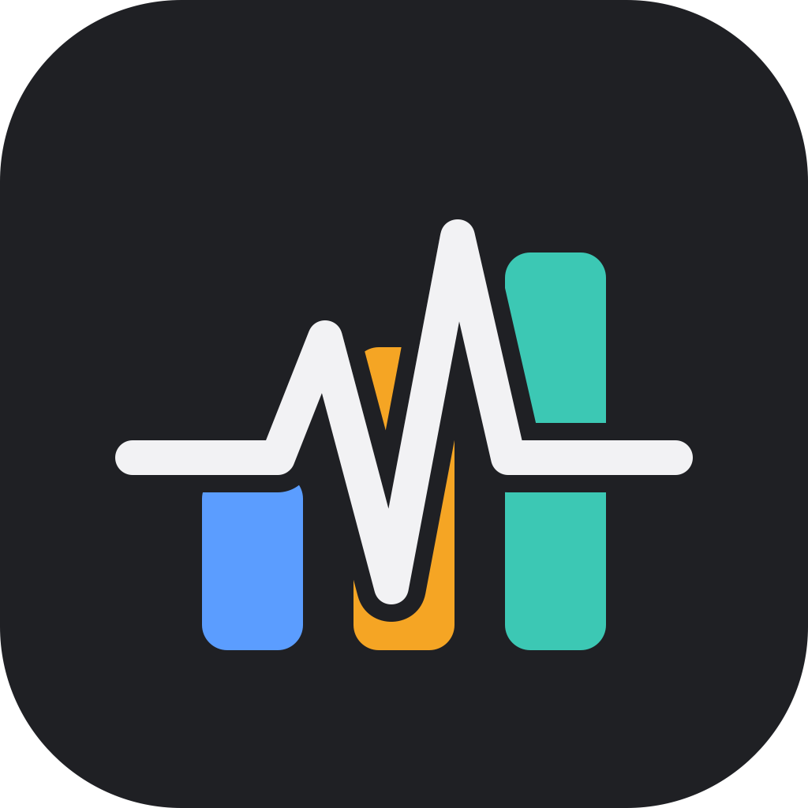
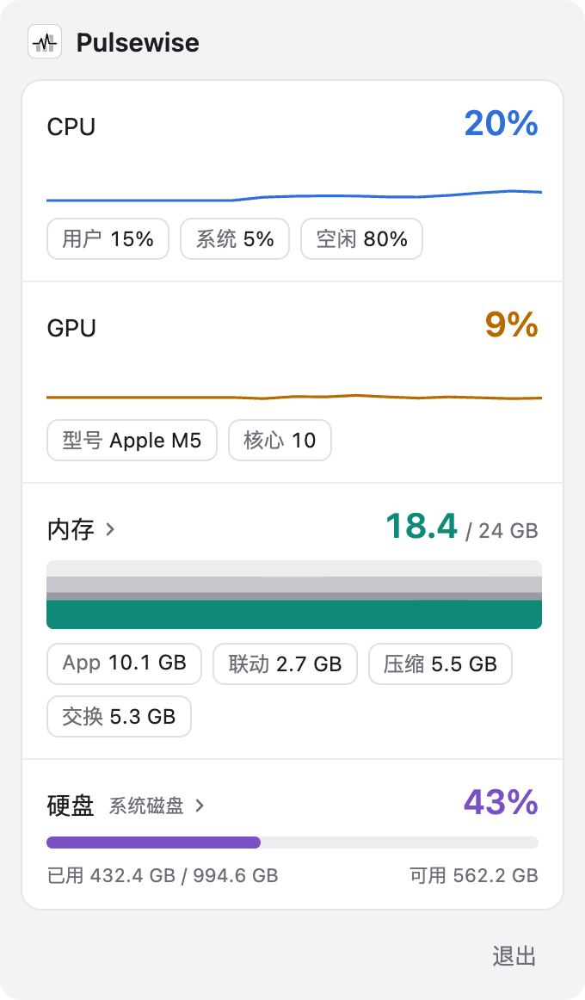

<p align="center">
  
</p>

<h1 align="center">Pulsewise</h1>

<p align="center">在 Mac 菜单栏查看 CPU、GPU、内存和硬盘使用情况。</p>

<p align="center">
  
  
  
</p>

<p align="center"><b>简体中文</b> · <a href="README.en.md">English</a></p>

<p align="center">
  
</p>

## 下载安装

打开最新的 DMG，将 `Pulsewise.app` 拖入“应用程序”并启动。菜单栏出现三根柱子就表示 Pulsewise 已在运行，Dock 中没有单独的图标。[前往 GitHub Releases 下载](https://github.com/FriendlyPasser/pulsewise/releases/latest)

发布版已签名并通过 Apple 公证，支持 macOS 13 及以上版本，适用于 Apple 芯片和 Intel Mac。界面跟随系统语言，支持简体中文和英文。

## 查看菜单栏和面板

三根柱子默认显示 CPU、GPU 和内存使用率，每秒刷新。将指针移到图标上可查看百分比。要加入硬盘使用率或隐藏某项指标，右键点击图标，打开 **菜单栏显示** 并勾选需要的项目。下次启动时会保留你的选择。

点击图标可查看全部四项指标，包括菜单栏中隐藏的项目。面板显示 CPU 和 GPU 最近 17 次采样的走势、内存分类占用，以及系统盘的已用和可用容量。按 Esc 可收起面板。

## 查找占用内存的应用和占用硬盘的大文件

点击面板中的 **内存** 或 **硬盘** 打开详情窗口。通过窗口顶部的标签可以在两者之间切换。

- **内存** 页用曲线显示 App、联动和压缩内存的变化，并单列交换空间用量。下方按物理内存占用排列当前用户的应用，辅助进程计入所属应用。展开应用可查看各进程的用量，没有归属应用的进程单独列出。
- **硬盘** 页可选择目录，按文件实际占用的磁盘空间列出最大的 100 个文件。扫描可以中途取消，结果可在 Finder 中显示。遇到当前用户无权读取的目录，扫描摘要会列出跳过的情况。

## 登录启动与更新

右键点击菜单栏图标，勾选 **登录时打开** 即可随登录启动。发布版会自动检查并下载更新，准备就绪后点击面板中的 **更新** 即可重启。也可以从右键菜单选择 **检查更新**。如果替换已安装的应用需要管理员权限，macOS 会提示授权。

## 从源码构建

需要 macOS、Go 1.27.3+ 以及 Xcode 命令行工具（采样代码使用 cgo）。

```sh
git clone https://github.com/FriendlyPasser/pulsewise.git
cd pulsewise
go build -o bin/pulsewise .
./bin/pulsewise
```

调试面板页面时，可以让它在浏览器里运行，不启动菜单栏：

```sh
./bin/pulsewise -web 127.0.0.1:8765
```

在浏览器中打开 `http://127.0.0.1:8765/` 即可查看面板。

## 开发

[架构说明](docs/architecture.md)介绍模块职责、依赖方向和并发约定。

运行完整检查需要 Node.js 和 Python 3：

```sh
sh tools/check.sh
```

## 许可证

[MIT](LICENSE)
